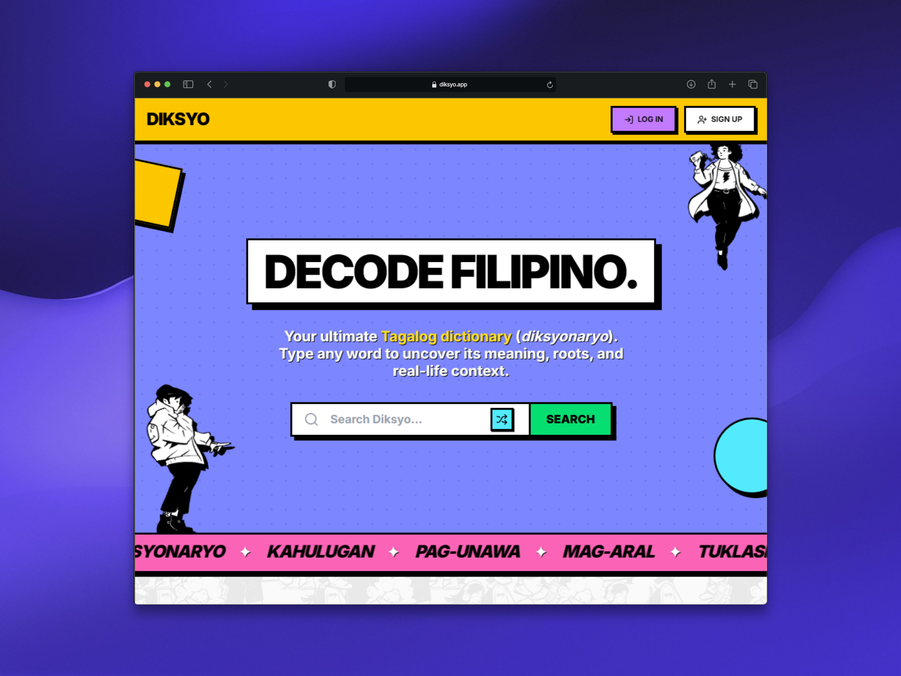

# Diksyo 📖

> A modern, community-driven Filipino vocabulary app

<p align="left">
  <a href="https://diksyo.app"></a>
  <a href="https://www.kaggle.com/datasets/tsunsan/diksyo-tagalog-vocabulary"></a>
  <a href="LICENSE"></a>
</p>

<p align="left">
  
  
  
  
  
  
  
  
</p>

---

## 🖼️ Application Preview

<p align="center">
  
</p>

---

## 📊 Dataset

The dictionary and Tagalog lexicon dataset powering Diksyo is available on Kaggle:
👉 **[View Diksyo Tagalog Vocabulary on Kaggle](https://www.kaggle.com/datasets/tsunsan/diksyo-tagalog-vocabulary)**

---

## ✨ Key Features

### 🤖 AI Tagalog Learning Assistant ("Diksyo AI")
- **RAG-Augmented Vocabulary Chat:** Ask conversational questions about grammar, nuanced contexts, etymology, and colloquial speech.
- **Multi-Model Failover Architecture:** Built on the Vercel AI SDK and Google AI SDK, featuring automated runtime fallback routing across `gemini-3.5-flash-lite`, `gemini-3.1-flash-lite`, and `gemma-4-31b-it`.
- **Edge Tool Caching:** Dictionary lookup results executed by AI tools are cached via Upstash Redis to deliver instant 0ms latency for repeated queries.
- **Strict Domain Guardrails:** System prompts and safety boundaries focus the AI exclusively on Filipino linguistics and cultural nuances.

### 🚙 Jeepney Journey Visual Progression & Gamification
- **Philippine Cultural Theme:** Gamified learning paths and visual UI progress styled after the iconic aesthetics of Philippine Jeepney signages.
- **Comprehensive Progression Metrics:** Real-time tracking of XP, mastery levels, daily learning streaks, and fastest quiz records.
- **Achievement Engine:** Asynchronous trigger system awarding badges for streaks, time-of-day milestones (*Night Owl*, *Early Bird*), and quiz accuracy.

### 🌳 Interactive Root Word Tree & Word Families ("Pamilya ng Salita")
- **Interactive Root Word Tree:** Visualizes root-to-derived word relationships, dynamically extracting and grouping word families by affix patterns (e.g. `MAG-`, `-AN`, `PAG- + -AN`).
- **Root & Etymology Mapping:** Links derived words directly to their base root words (`salitang-ugat`) with one-click navigation across the entire word family.
- **Homonym Disambiguation Routing:** Dedicated disambiguation pages to resolve identical spellings with distinct meanings, accents, and pronunciations.
- **Bilingual Search:** Fast full-text and fuzzy searching across both Tagalog words and English translations with `pg_trgm` GIN indexing.

### 🧠 Research-Backed Spaced Repetition (FSRS)
- **Free Spaced Repetition Scheduler (`ts-fsrs`):** Modern memory algorithm dynamically calculating memory stability, item difficulty, and next review intervals.
- **Specialized Quiz Modes:**
  - **Cloze Deletion:** Contextual fill-in-the-blank challenges from authentic sentence examples.
  - **Time-Attack Mode:** Rapid-fire active recall against a countdown timer.

### 🔍 Lexicon Explorer & Smart Search
- **Bilingual & Fuzzy Search:** Instant searching across Tagalog words and English translations with `pg_trgm` GIN indexing and Levenshtein distance "Did you mean?" typo suggestions.
- **Granular Multi-Dimensional Filters:** Filter vocabulary by traditional Filipino parts of speech (*Pangngalan*, *Pandiwa*, *Pang-uri*, etc.), difficulty levels (*Beginner*, *Intermediate*, *Advanced*), or isolate root words (*Salitang-Ugat Lamang*).
- **Text-to-Speech (TTS) Pronunciation:** Web Speech API synthesis for instant Tagalog audio pronunciations.
- **Spotlight Onboarding Tour:** Interactive guided walkthrough for new users explaining search, word cards, and vault mechanics.

### 📊 Learning Analytics, Heatmap & Leaderboards
- **365-Day Activity Heatmap:** GitHub-style daily contribution calendar tracking learning consistency throughout the year.
- **FSRS Memory Breakdown:** Visual metrics categorizing words across retention stages (*New*, *Learning*, *Reviewing*, *Mastered*) with top struggled words analysis.
- **Community Leaderboards:** Competitive weekly and all-time rankings for total XP and words mastered.

### 🗄️ Soft-Delete Vault & Restorative Data
- **Personal Vocabulary Vault:** Bookmark and practice words tailored to your study list.
- **Non-Destructive Archival:** Archive words via the `isArchived` flag in `app/actions/vault.ts`, allowing users to remove and restore vocabulary without wiping their underlying FSRS memory stability or review history.

### ☀️ Word of the Day & Discover Engine
- **Deterministic Daily Rotation:** Rotates words deterministically based on epoch day indexing, cached via Next.js Incremental Static Regeneration (ISR) for zero unnecessary database queries.

### 👥 Community Submissions & Social Moderation
- **Crowd-Sourced Accuracy:** Community upvoting, downvoting, definitions verification, and discussion feeds to evolve the lexicon organically and refine AI-generated baseline definitions.

### 🖼️ Dynamic OpenGraph & Rich SEO
- **On-the-Fly Social Previews:** Dynamically generates high-contrast Neobrutalist social share cards using `@vercel/og`.
- **Structured Data:** Automated Schema.org `DefinedTerm` JSON-LD metadata for search engine indexing and discoverability.
- **Programmatic Dynamic Sitemap:** Generates a database-driven dynamic sitemap (`app/sitemap.ts`) mapping all word routes, homonym disambiguation pages, and static paths with 24-hour cache revalidation.

---

## 🛠️ Tech Stack

| Category | Technology | Purpose |
| :--- | :--- | :--- |
| **Framework** | [Next.js 16](https://nextjs.org/) (App Router, Turbopack) | Server Components, Server Actions, API routes, and static caching |
| **UI Library** | [React 19](https://react.dev/) | Core UI rendering and concurrent features |
| **Language** | [TypeScript](https://www.typescriptlang.org/) | Full-stack strict type safety |
| **Styling & Design** | [Tailwind CSS v4](https://tailwindcss.com/), [Base UI](https://base-ui.com/), [shadcn/ui](https://ui.shadcn.com/) | Neobrutalist high-contrast design system, hard shadows, bold borders |
| **Illustrations & Icons** | [Transhumans](https://www.transhumans.xyz/) by [Pablo Stanley](https://twitter.com/pablostanley), [Lucide React](https://lucide.dev/), [Sonner](https://sonner.emilkowal.ski/) | Character art, UI iconography, and toast notifications |
| **Motion** | [Framer Motion](https://www.framer.com/motion/) | Rigid, tactile spring animations |
| **Database** | [PostgreSQL](https://www.postgresql.org/) via [Supabase](https://supabase.com/) | Relational word storage with `pg_trgm` & `fuzzystrmatch` extensions |
| **ORM** | [Drizzle ORM](https://orm.drizzle.team/) | Type-safe schema definitions, relationships, and queries |
| **Authentication** | [Supabase Auth](https://supabase.com/auth) (`@supabase/ssr`) | Google OAuth, email auth, and Row Level Security (RLS) |
| **State & Validation** | [Zustand](https://zustand-demo.pmnd.rs/), [Zod](https://zod.dev/) | Shared client state management and runtime form/payload validation |
| **Spaced Repetition** | [ts-fsrs](https://github.com/open-spaced-repetition/ts-fsrs) | FSRS v5 spaced repetition algorithm for memory retention |
| **AI Architecture** | [Vercel AI SDK](https://sdk.vercel.ai/), [Google AI SDK](https://ai.google.dev/), `@assistant-ui/react` | Streaming conversational assistant with multi-model failover routing |
| **Rate Limiting & Cache** | [Upstash Redis](https://upstash.com/) (`@upstash/ratelimit`, `@upstash/redis`) | Edge rate-limiting for mutations, chat protection, and tool result caching |
| **SEO & Analytics** | `@vercel/og`, Dynamic `sitemap.ts`, `@vercel/analytics`, `@vercel/speed-insights` | Dynamic OpenGraph images, DefinedTerm JSON-LD, programmatic sitemap, performance monitoring |

---

## 🔍 Engineering Transparency & Architecture

### 1. Generated Data (Zero Scraping)
All baseline lexicon and morphological data was synthetically generated and structured without scraping any copyrighted third-party websites. Because initial dataset generation can occasionally introduce edge-case hallucinations or non-standard root alignments, the platform uses community moderation (upvoting, downvoting, and user submissions) to iteratively crowdsource corrections.

### 2. Free-Tier Resilience Engineering
Running the entire production infrastructure on free-tier services required intentional defensive architecture:
- **Connection Pool Protection:** Database connection strings strictly limit pooling concurrency (`connection_limit=5`, `connect_timeout=10`).
- **Fail-Fast Client Timeouts:** Postgres client configurations enforce `connect_timeout: 5` and `idle_timeout: 5` to prevent serverless execution hangs and Vercel 504 gateway timeouts.
- **Exponential Backoff:** All database reads and Supabase API calls in Server Actions are wrapped with `withExponentialBackoff()` (see `lib/db-utils.ts`) to absorb transient connection spikes.
- **Rate-Limiting & AI Failover:** Upstash Redis token-bucket rate limiters safeguard API endpoints, while the custom AI fallback provider automatically degrades from `gemini-3.5-flash-lite` to `gemini-3.1-flash-lite` or `gemma-4-31b-it` when upstream rate limits occur.

### 3. Neobrutalist Design System & Art
- **Jeepney Signage Inspiration:** The visual identity takes direct inspiration from Philippine Jeepney route placards and urban street signages (thick `2px` / `4px` black borders, hard non-blurred drop shadows `shadow-[4px_4px_0_0_#000]`, zero-radius geometry `rounded-none`, and high-contrast color blocks).
- **Character Illustrations:** Features the expressive **Transhumans** illustration library created by **Pablo Stanley**.

---

## 🚀 Getting Started

### 1. Prerequisites
- **Node.js:** `v18.18.0` or later
- **Package Manager:** `npm` (or `pnpm` / `bun`)
- **Supabase Account:** Free tier database with PostgreSQL
- **Upstash Redis Account:** Free tier Redis database
- **Google AI Studio Key:** Free Gemini API key

### 2. Installation & Setup

1. **Clone the repository:**
   ```bash
   git clone https://github.com/tsunsan/diksyo.git
   cd diksyo
   ```

2. **Install dependencies:**
   ```bash
   npm install
   ```

3. **Configure environment variables:**
   Copy the example environment template and fill in your keys:
   ```bash
   cp .env.example .env.local
   ```
   *(Refer to the detailed comments inside [`.env.example`](.env.example) for setup guidance).*

4. **Supabase Database Setup (Extensions & RPC Functions):**
   In your Supabase SQL Editor, run the following script to enable full-text fuzzy matching and create the secure user account/data deletion function:

   ```sql
   -- 1. Enable Required PostgreSQL Extensions
   CREATE EXTENSION IF NOT EXISTS pg_trgm;
   CREATE EXTENSION IF NOT EXISTS fuzzystrmatch;

   -- 2. Create User Account & Data Deletion Function (for GDPR / profile deletion)
   CREATE OR REPLACE FUNCTION delete_user()
   RETURNS void
   LANGUAGE plpgsql
   SECURITY DEFINER
   AS $$
   BEGIN
     -- 1. Delete the user's progress (FSRS data)
     DELETE FROM public.user_progress WHERE user_id = auth.uid();
     
     -- 2. Delete the user's unlocked achievements
     DELETE FROM public.user_achievements WHERE user_id = auth.uid();
     
     -- 3. Delete the user's daily activity (heatmap logs)
     DELETE FROM public.daily_activity WHERE user_id = auth.uid();

     -- 4. Delete the user's profile (XP, level, settings)
     DELETE FROM public.user_profiles WHERE user_id = auth.uid();

     -- 5. Finally, delete the user from the auth system
     DELETE FROM auth.users WHERE id = auth.uid();
   END;
   $$;

   -- Revoke execute permissions from the public, just in case
   REVOKE EXECUTE ON FUNCTION delete_user FROM public;

   -- Explicitly grant execute to authenticated users only
   GRANT EXECUTE ON FUNCTION delete_user TO authenticated;
   ```

5. **Sync Database Schema:**
   Push the Drizzle schema to your Supabase PostgreSQL instance:
   ```bash
   npx drizzle-kit push
   ```

6. **Start the Development Server:**
   ```bash
   npm run dev
   ```
   Open [http://localhost:3000](http://localhost:3000) in your browser.

---

## 🗺️ MVP Mindset & Future Roadmap

Diksyo is designed with a lightweight Minimum Viable Product mindset, prioritizing community feedback before layering on complex modules.

| Category | Planned Features |
| :--- | :--- |
| **🎮 Gameplay** | Multiplayer real-time duels, additional word games (*Chain-it*, *Wordle*, *Sentence Builder*, *Reading Comprehension*). |
| **🎨 Customization** | Custom user-created study lists, comprehensive public profiles, and full Dark Mode palette. |
| **👥 Community** | User word submissions, full comment threads on words, and advanced community moderation dashboards. |
| **🌟 Immersion** | Contextual linguistic GIFs, user-submitted example illustrations, and audio pronunciation clips. |
| **🛡️ Quality** | Ongoing dataset refinement, dialect tagging (Cebuano, Ilocano, Hiligaynon), and Baybayin script support. |
| **📬 Engagement** | Daily study habit push notifications and weekly streak digest emails. |
| **⚡ Technicals** | Public REST / GraphQL dictionary API for developers, offline PWA / native mobile support. |

---

## 📜 License

Distributed under the **Apache License 2.0**. See the [`LICENSE`](LICENSE) file for more information.


